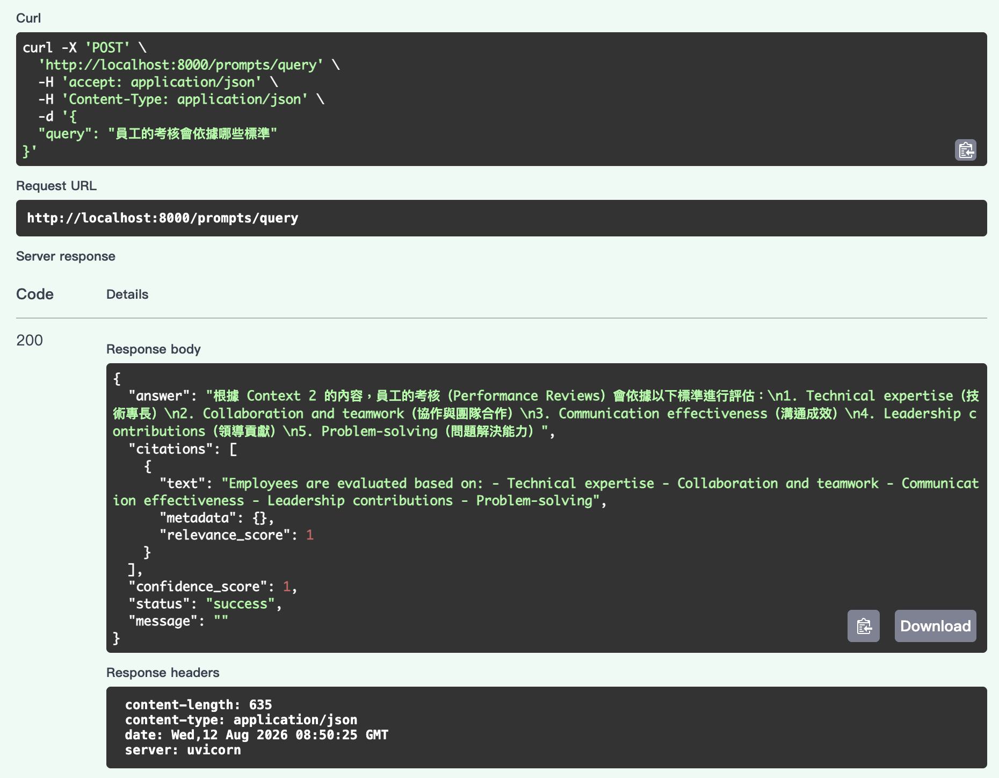
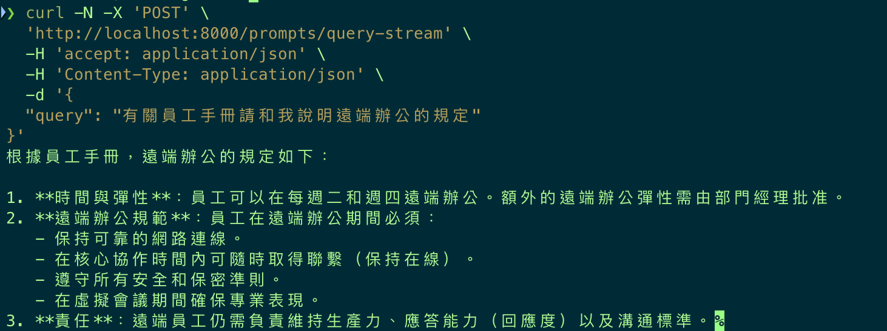

# simple-rag

一個以 FastAPI、LangChain、Gemini 與 ChromaDB 實作的實驗性 RAG API。
系統會先改寫查詢，再以語意與關鍵字混合檢索文件；當檢索內容不足時拒絕生成答案。

## 流程

```text
問題 → QueryRemaster → Hybrid Retriever → Cohere Reranking → Context Evaluator → Gemini 回答
```

主要元件位於 `src/components/`：

- `query_remaster.py`：改寫查詢並擷取關鍵字
- `retriever.py`：ChromaDB 向量檢索、BM25 關鍵字檢索、RRF 融合與 Cohere reranking
- `evaluator.py`：判斷 context 是否足以回答問題
- `response_generator.py`：產生同步或 streaming 回答
- `rag_workflow.py`：串接完整 RAG 流程

## 需求

- Python 3.13+
- [`uv`](https://docs.astral.sh/uv/)
- Google Gemini API key
- Cohere API Key

## 設定與啟動

在專案根目錄建立 `.env`：

```env
GOOGLE_API_KEY=your-google-api-key
COHERE_API_KEY=your-cohere-api-key
VECTOR_STORE=./chroma_db
```

模型與文件切分設定可選擇性覆寫：

```env
REMASTER_MODEL=gemini-3.5-flash-lite
EMBEDDING_MODEL=gemini-embedding-001
EVALUATOR_MODEL=gemini-3.5-flash
RERANKER_MODEL=rerank-v3.5
ANSWER_MODEL=gemini-3.6-flash
CHUNK_SIZE=500
CHUNK_OVERLAP=50
```

安裝依賴並啟動 API：

```bash
uv sync
cd src
uv run python run.py
```

服務預設位於 <http://localhost:8000>。API 文件：

- Swagger UI：<http://localhost:8000/docs>
- ReDoc：<http://localhost:8000/redoc>

## API

### 查詢

```bash
curl -X POST http://localhost:8000/prompts/query \
  -H 'Content-Type: application/json' \
  -d '{"query":"遠端辦公的規定是什麼？"}'
```

回應包含 `answer`、`citations`、`confidence_score` 與 `status`。若 context 不足，`status` 會是 `insufficient_context`。

檢索會先由 Chroma 向量檢索與 BM25 關鍵字檢索取得候選文件，再使用 EnsembleRetriever 的 RRF 融合排名。融合結果會交給 Cohere reranker 進行第二階段排序，最後取前兩筆文件作為 context。若 Cohere reranker 暫時失敗，系統會回退到 RRF 結果。

#### Swagger UI 查詢介面


#### Streaming endpoint 回應


### Streaming 查詢

```bash
curl -N -X POST http://localhost:8000/prompts/query-stream \
  -H 'Content-Type: application/json' \
  -d '{"query":"遠端辦公的規定是什麼？"}'
```

### 文件管理

載入 `src/docs/sample_doc.pdf`：

```bash
curl -X POST http://localhost:8000/documents/load_doc \
  -H 'Content-Type: application/json' \
  -d '{"path":"sample_doc","extension":"pdf"}'
```

其他可用路由：

| 方法 | 路徑 | 用途 |
| --- | --- | --- |
| `POST` | `/documents/predefined` | 載入預設文件 |
| `POST` | `/documents` | 新增文字文件 |
| `GET` | `/documents` | 查看目前文件 |
| `DELETE` | `/documents` | 清空文件集合 |
| `DELETE` | `/documents/id/{id}` | 刪除指定文件 |
| `GET` | `/collections` | 查看 ChromaDB collections |

新增文件的格式為：

```json
[{"text":"文件內容","metadata":{"source":"example"}}]
```

## 專案定位

這是用於學習與實驗的 POC，尚未包含 production 所需的驗證、權限控管、完整測試、可觀測性與 streaming 錯誤協定。

## 參考資料

- [RAG Explained Simply with a Real Project](https://www.freecodecamp.org/news/rag-explained-simply-with-a-real-project/)
- [Emissary-Tech/legit-rag](https://github.com/Emissary-Tech/legit-rag)
